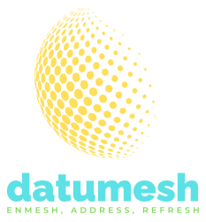

<p align="center"></p>

# datumesh-spec

Datumesh is an open protocol for addressable, verifiable data cells: a name, a resolver, a signed answer, and a lineage you can follow.

This repository is the protocol's specification ([SPEC.md](SPEC.md)), its JSON Schemas ([schemas/](schemas/)), its test vectors ([vectors/](vectors/)), and a reference canonicaliser used to generate and check them ([tools/canon.py](tools/canon.py)). The canonicaliser is a test tool, not a library.

## In ten lines

```text
cell://rates.example.org/fx_rate?base=EUR&date=2024-03-15&quote=USD&asof=2024-03-16T09:00:00.000000Z

{"cell": {"ns": "rates.example.org", "fn": "fx_rate", "fn_hash": "88445cdd…", "args": {"base": …, "date": …, "quote": …}},
 "type": "number", "value": "1.0892", "valid": {"date": …}, "asof": "2024-03-16T09:00:00.000000Z", "tx": "2024-03-15T16:00:00.000000Z",
 "publisher": "rates.example.org", "computed_by": "rates.example.org#d712b32a2cc5cb7c", "inputs": [], "licence": "CC-BY-4.0",
 "summary": "1 EUR was worth 1.0892 USD at the 15 March 2024 reference rate.", "sig": "e2d778df…"}      # examples/receipt.json

$ python3 tools/canon.py verify examples/receipt.json examples/keyenv.json
OK 501f744d910c585859a5be4f3b62385ed0d6803db53dbbf95dff5097a68bee0d signed by rates.example.org#d712b32a2cc5cb7c
```

The URI names one cell: a function, rooted in a domain its publisher controls, applied to typed arguments, as of a transaction time. The receipt is that cell's signed answer. Its hash is SHA-256 over the RFC 8785 canonical JSON of everything except `sig`, and `sig` is Ed25519 over the same bytes. Verification finds the key `computed_by` names at `https://rates.example.org/.well-known/datumesh.json` (here supplied offline by `keyenv.json`) and checks the signature.

## Integrations (design)

[integrations/spreadsheets](integrations/spreadsheets/SPEC.md) specifies a future Excel add-in and Google Sheets add-on, with conversion test cases written ahead of the code. It is non-normative and not built.

## Running the tests

The tools need Python 3.13 or later (for Unicode 15.1) and PyNaCl. Schema tests need `jsonschema`.

```sh
pip install pynacl jsonschema
python3 tools/canon.py check                 # every vector
cd tests && python3 -m unittest -v           # all tests; DATUMESH_FUZZ_N=100000 by default
```

With Docker only:

```sh
docker run --rm -v "$PWD":/w -w /w python:3.13-slim sh -c \
  'pip -q install pynacl==1.5.0 jsonschema==4.23.0 && python tools/canon.py check && cd tests && python -m unittest -v'
```

Independent cross-check of every canonical form, hash and signature with the `canonicalize` npm package and Node's crypto:

```sh
docker run --rm -v "$PWD":/w -w /w/tests/oracle node:22-slim sh -c 'npm install --silent && node oracle.mjs'
```

`python3 tools/gen_vectors.py` regenerates `vectors/` and `examples/` byte for byte.

## Licence

Apache License 2.0. See [LICENSE](LICENSE).
